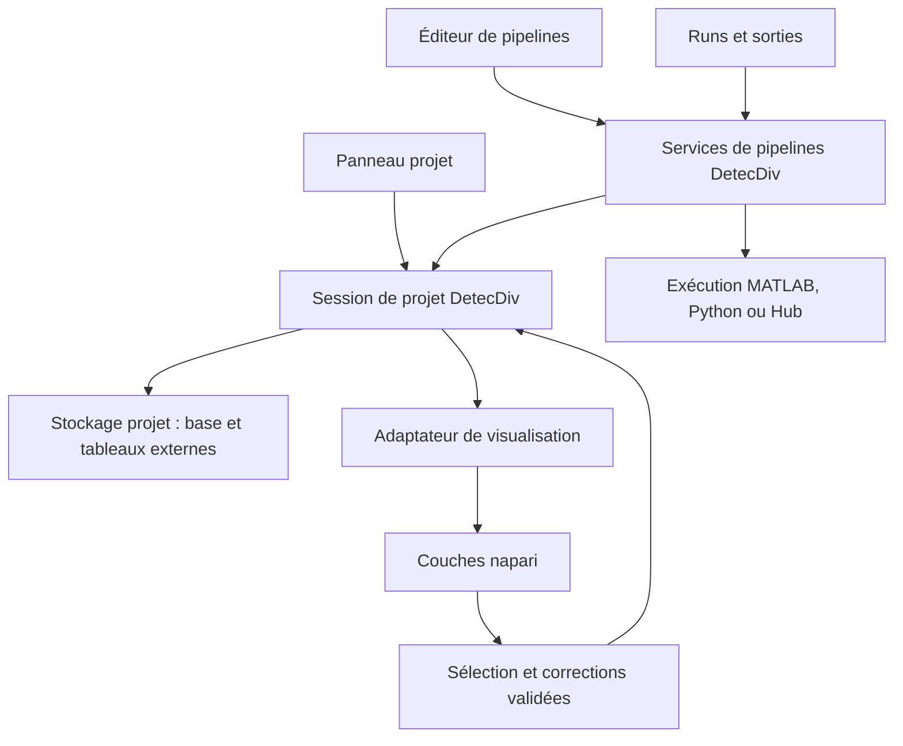

# Intégration des projets et pipelines DetecDiv dans napari

Date : 16 octobre 2026. Statut : architecture proposée pour le prototype Python. Cette note complète la [stratégie de stockage et de reprise de pyDetecDiv](python_project_storage_architecture.md).

Le [premier prototype concret](napari_first_prototype.md) détaille l’ouverture des projets existants, les lecteurs distincts pour bruts et ROI HDF5, la navigation entre ces sources et le graphe de pipeline consultable. Ce premier jalon d’exploration précède les étapes d’annotation et d’exécution décrites ci-dessous.

## Orientation

Napari est l’interface candidate retenue pour le prototype du futur DetecDiv Python : exploration des projets, construction de pipelines, lancement et suivi des runs, inspection et correction des résultats. L’objectif est de préserver la richesse fonctionnelle de DetecDiv en réunissant les tâches autour de l’image dans un même espace de travail.

La répartition proposée est la suivante : **napari fournit le viewer et accueille les panneaux ; le cœur DetecDiv possède le projet, ses données et les règles d’exécution**. Les pipelines doivent pouvoir fonctionner avec les mêmes contrats depuis napari, un script ou un worker sans interface.

Cette orientation fait évoluer la stratégie de reprise de Fred. Ses adaptateurs, traitements et widgets utiles restent des sources de réutilisation. La coque principale de son application et son viewer ne sont plus des passages obligés : le prototype évalue directement leur intégration dans une interface napari.

L’[étude de Cell-ACDC](cell_acdc_comparison.md) apporte des exemples métier et une piste d’interopérabilité optionnelle. L’utilisateur souhaite conserver l’étendue des fonctions DetecDiv et améliorer leur cohérence visuelle ; l’interface Cell-ACDC ne constitue pas la cible de la migration. Le prototype doit pouvoir démontrer son parcours principal dans napari, sans imposer un détour par une autre application.

## Une interface centrée sur l’image

Le viewer principal doit rester le point d’ancrage pendant la navigation, l’annotation, le réglage d’un module et la lecture des mesures. Les outils apparaissent selon la tâche et la sélection. Le choix d’une FOV, d’une ROI ou d’une cellule définit le contexte partagé par les panneaux, les couches et les courbes.

| Zone de travail | Fonction proposée |
| --- | --- |
| Centre | Image active, masques et objets sélectionnés, navigation temporelle |
| Navigateur latéral | Projet, FOV, ROI et recherche ; accès aux sorties et runs |
| Panneau contextuel | Paramètres du module, propriétés de l’objet ou outils d’annotation selon la tâche |
| Zone inférieure contextuelle | Courbes liées à la sélection ou progression du run |
| Vue du pipeline | Graphe et connexions dans le même espace, agrandissable lorsque sa construction l’exige |

Cette disposition est une proposition à tester sur les écrans utilisés. Les panneaux doivent pouvoir se replier et se remplacer selon la tâche. Les anciens callbacks ne seraient pas transposés chacun dans une nouvelle fenêtre ou un panneau permanent. Le prototype doit vérifier que la place laissée à l’image et la continuité de navigation restent suffisantes.

Passer de l’annotation au réglage d’un nœud préserverait le projet, la sélection, la frame et, lorsque les coordonnées sont compatibles, le zoom et la caméra. La sélection d’exécution resterait explicite et indépendante de la vue active. Le changement de tâche ne relancerait pas un chargement complet du projet.

Le graphe de pipeline et le viewer seraient liés : sélectionner un nœud permettrait d’inspecter ses entrées et sorties ; une ressource affichée permettrait de retrouver son producteur. La modification d’un paramètre invaliderait la prévisualisation correspondante. Une prévisualisation serait identifiée comme telle, avec son périmètre, avant la publication d’une sortie de run.

Un premier parcours de référence serait : ouvrir une ROI, choisir un nœud de segmentation et régler ses paramètres, afficher un aperçu dans le viewer, lancer sur la sélection de projet, puis examiner une mesure dérivée du masque obtenu. Cliquer un point de la courbe ramènerait à la frame et à l’objet correspondants. Ce parcours mesurerait la continuité de l’interface autant que le fonctionnement des composants.

Les moteurs tels que Cellpose resteraient des modules métier derrière les contrats DetecDiv. Leur choix n’imposerait pas l’interface de leur application d’origine. La gestion des templates, des runs et de la provenance doit être intégrée au parcours visuel dès le prototype.

La base SQLite par projet soutiendrait ce contexte partagé : identités, sélections enregistrées si nécessaire, annotations révisées, références de ressources et runs. Les tableaux d’images resteraient externes ; l’état de présentation et les caches conserveraient un rôle distinct de la persistance scientifique.

## Forme de l’intégration

Le premier choix serait un plugin napari `npe2` proposant des panneaux Qt. Les contributions de widgets permettent d’accéder au viewer et aux couches ; les API de docking accueillent des widgets Qt ou magicgui. Elles constituent les points d’entrée documentés pour cet assemblage. Références : [contributions des plugins](https://napari.org/stable/plugins/building_a_plugin/guides.html), [création de widgets](https://napari.org/stable/howtos/extending/magicgui.html).

| Forme | Usage proposé |
| --- | --- |
| Plugin DetecDiv dans napari | Cible du premier prototype : panneaux métier et viewer dans une même fenêtre |
| Lanceur DetecDiv ouvrant napari avec ses panneaux | Évolution possible pour proposer un démarrage directement centré sur le projet |
| Application Qt dédiée intégrant un viewer napari | À évaluer si les limites de disposition ou de navigation du premier assemblage le justifient |

Le code viserait les API publiques de napari. Les widgets repris de Fred devraient utiliser un binding Qt compatible avec celui de l’environnement napari et partager la même application Qt. Le démarrage vérifierait cet assemblage avant l’intégration des dépendances lourdes des modèles.

## Répartition des responsabilités

Les noms de composants ci-dessous désignent des responsabilités à implémenter, pas des classes déjà disponibles :

| Composant | Responsabilité |
| --- | --- |
| Session de projet | Projet ouvert, sélection scientifique, correspondances d’identifiants et événements métier |
| Service de stockage | Lecture des ressources, requêtes de mesures, transactions d’annotations et révisions |
| Service de templates | Chargement et sauvegarde des pipelines, nœuds, ports, paramètres et références de modules |
| Service d’exécution | Validation, préparation du snapshot et du run, soumission, annulation et reprise |
| Adaptateur napari | Conversion en couches, coordonnées et liens entre sélection, images et mesures |
| Panneaux Qt | Présentation et édition ; appels aux services pour les opérations métier |

Le cœur ne devrait dépendre ni de `napari.Viewer`, ni de widgets Qt. La session ne serait pas un singleton global. Le prototype aurait un projet actif par fenêtre ; une seconde fenêtre pourrait disposer d’une autre session sans mélanger les sélections et ressources.

## Gestion du projet entier

L’arbre du projet présenterait les sources, FOV, ROI, puis les cellules ou trajectoires lorsqu’elles existent, ainsi que les templates liés, les runs et leurs sorties. Il chargerait les détails et résultats à la demande depuis le service de projet.

La liste des couches conserverait son rôle de présentation des ressources actuellement inspectées. Ouvrir un projet de milliers de ROI ne devrait pas créer autant de couches ni lire leurs images. Une sélection dans l’arbre chargerait une vue FOV ou ROI avec un nombre borné de couches gérées.

Il faudrait distinguer explicitement :

- **la vue active**, par exemple une ROI et ses canaux affichés ;
- **la sélection d’exécution**, par exemple toutes les ROI de trois FOV ;
- **les filtres de recherche**, par exemple les ROI comportant une division ou une étape en échec.

Ces trois états pourraient être liés par une action explicite, mais le changement de couche sélectionnée ne redéfinirait pas silencieusement le périmètre d’un run. L’UI afficherait le nombre de FOV, ROI, frames et canaux concernés avant de soumettre le calcul.

La réouverture reconstruirait le projet depuis sa persistance. Les préférences de présentation — couche visible, caméra, contraste et panneaux — seraient stockées comme état de vue distinct. Une sauvegarde de couches napari ne remplacerait pas la sauvegarde du projet, de ses templates et de ses runs : les writers documentés reçoivent les données et attributs de couches. Voir les [contributions de writers](https://napari.org/stable/plugins/building_a_plugin/guides.html#writers).

## Correspondance des données avec les couches

| Donnée DetecDiv | Présentation proposée |
| --- | --- |
| Canal d’image brut ou dérivé | Couche `Image`, avec axes et calibration définis |
| Segmentation dense | Couche `Labels`, liée à une sortie et à sa révision |
| Contour de ROI ou zone d’exclusion | Couche `Shapes` alimentée depuis la géométrie du projet |
| Points d’annotation ou événements localisés | Couche `Points` lorsque leurs coordonnées le permettent |
| Trajectoires de cellules | Couche `Tracks`, avec correspondance explicite entre identifiants locaux et objets du projet |
| Lignée et événements de division | Relations du modèle métier ; projection possible vers le graphe des tracks et une vue dédiée |
| Séries quantitatives et tableaux de résultats | Panneau de courbes et tables synchronisé, interrogeant le stockage |

Napari expose des métadonnées de couches et des transformations spatiales ; `Tracks` accepte un graphe d’associations entre trajectoires. Ces capacités permettent la projection des données, sans définir à elles seules les identités biologiques ni les règles de lignée. Références : [Layer](https://napari.org/stable/api/napari.layers.Layer.html), [Tracks](https://napari.org/stable/api/napari.layers.Tracks.html).

Chaque couche gérée porterait des références légères : projet, ressource, FOV/ROI, sortie, run et révision selon le cas. Son nom et sa position dans la liste ne seraient pas des identifiants scientifiques. Renommer, masquer ou retirer une couche ne supprimerait pas le résultat du projet.

Les valeurs des labels nécessiteraient une table de correspondance vers les cellules du projet ; un entier de masque ne serait pas supposé être un identifiant global. Les conversions entre coordonnées de crop, FOV et monde physique resteraient explicites. Pour une ROI mobile, l’adaptateur appliquerait la transformation de la frame affichée.

Un index temporel napari serait relié aux frames absolues et aux temps d’acquisition. Les séquences avec frames manquantes ou pas de temps irrégulier utiliseraient cette correspondance ; une échelle temporelle constante ne suffit pas à les représenter fidèlement dans les courbes et événements.

## Construction et exécution des pipelines

Le panneau pipeline représenterait les templates DetecDiv actuels : nœuds, ports nommés, ressources connectées, paramètres et contraintes. Les formulaires seraient dérivés des descriptions de modules. Magicgui pourrait fournir des contrôles simples ; le graphe et les règles de validation resteraient sous la responsabilité DetecDiv.

Un template porterait des sélecteurs et références symboliques, résolus sur le projet choisi au moment du run. Les connexions ne seraient pas des références à des objets `Layer` en mémoire. Le pipeline resterait sauvegardable en JSON, transférable et exécutable sans afficher ses données.

Le parcours proposé serait : choisir ou créer un template à partir d’un exemple, ajouter des modules de la bibliothèque, connecter les ports compatibles, définir les paramètres, tester sur un petit périmètre, puis lancer sur la sélection de projet. Le prototype commencerait par l’édition guidée d’un template existant ; l’éditeur complet de connexions suivrait.

La distinction entre plugin napari et module de pipeline est essentielle. Un plugin napari peut fournir une interface ou un lecteur. Pour devenir un module de calcul reproductible, une opération doit aussi déclarer ses paramètres, entrées, sorties, versions, politiques d’écriture et conditions d’exécution sans GUI. La simple disponibilité d’un bouton dans napari ne garantit pas ce contrat.

Des outils existants méritent une inspection ciblée. [napari-workflows](https://github.com/haesleinhuepf/napari-workflows) propose des structures de workflows d’images et plusieurs interfaces associées. Ils constituent des pistes de réutilisation pour les interactions et graphes. Leur équivalence avec les sélections de projet, runs et politiques de reprise DetecDiv reste à établir.

La compatibilité doit être vérifiée avant d’en faire une dépendance : le README de [napari-workflow-inspector](https://github.com/haesleinhuepf/napari-workflow-inspector), consulté le 16 octobre 2026, indique une incompatibilité avec napari 0.6.0 et versions ultérieures. Le prototype ne dépendrait donc pas de cet inspecteur pour son éditeur.

Le moteur existant assurerait d’abord la validation et l’exécution MATLAB. Le panneau de runs présenterait progression, erreurs, sorties et provenance. Une sortie pourrait être inspectée à la demande dans napari, même si son calcul a porté sur beaucoup de ROI non affichées. Les traitements Python et le Hub utiliseraient ensuite les mêmes services de soumission et contrats.

## Lecture et corrections interactives

Le viewer recevrait des tableaux permettant la lecture à la demande, avec un cache borné. Napari documente ce comportement pour les images utilisant notamment Dask ou Zarr. Cela doit être adapté et mesuré pour les `.h5` DetecDiv et leurs conventions de canaux. Voir la [documentation Image](https://napari.org/stable/howtos/layers/image.html).

La première version afficherait les masques existants en consultation et persisterait une annotation simple dans la base. L’édition de segmentation viendrait avec une zone ou un bloc de travail matérialisé, une révision de départ et une publication explicite. Il faut vérifier les capacités d’édition du support de tableau retenu avant de proposer la peinture sur un volume chargé à la demande.

La sélection, les changements de frame et les courbes seraient synchronisés par la session. Une réponse de lecture devenue obsolète après un changement de ROI serait ignorée. Une modification de masque ou de géométrie passerait par le service de stockage et sa vérification de révision ; l’événement d’une couche ne provoquerait pas une réécriture complète du projet.

Les lectures coûteuses et le suivi des processus resteraient hors du thread de l’interface. Les résultats seraient transmis à l’UI pour mettre à jour les couches sur son thread. Le mécanisme de workers Qt ne remplacerait pas le processus ou worker de calcul responsable du run. Voir le [guide de threading napari](https://napari.org/stable/guides/threading.html).

## Adaptation du premier prototype

Les étapes P1 à P6 de la note principale restent applicables avec napari comme interface candidate prioritaire :

| Étape | Complément napari |
| --- | --- |
| P1 | Ouvrir napari avec les panneaux projet, pipeline/runs et mesures ; vérifier la compatibilité des widgets repris de Fred |
| P2 | Construire la session de projet et les lecteurs indépendants du viewer ; exposer uniquement les ressources sélectionnées |
| P3 | Afficher une FOV avec contours de ROI, passer à une ROI avec image et labels, puis synchroniser sa courbe ; conserver ce contexte lors du changement de tâche |
| P4 | Enregistrer dans napari une annotation identifiée par projet, ROI et frame ; vérifier sa présence après fermeture et sa restitution dans le même parcours |
| P5 | Charger le graphe JSON, relier les nœuds aux ressources du viewer, modifier un paramètre, sélectionner plusieurs ROI dont certaines non affichées, puis valider et lancer le run MATLAB |
| P6 | Afficher une sortie à la demande, retrouver son nœud producteur et rouvrir le projet avec les mêmes données et runs |

La démonstration déterminante consisterait à n’afficher qu’une ROI tout en exécutant le pipeline sur plusieurs ROI de plusieurs FOV, puis à explorer leurs résultats sans les avoir chargées pendant le calcul. Ce scénario vérifie que la gestion de projet et l’exécution dépassent le contenu du viewer.

Les essais supplémentaires vérifieraient qu’un renommage ou retrait de couche ne modifie pas les données persistées, qu’un résultat tardif n’apparaît pas dans le mauvais projet, et qu’une annotation non enregistrée ne soit pas présentée comme confirmée. Ils vérifieraient aussi le lancement du même périmètre sans napari et la concordance des sorties avec celles obtenues depuis l’UI.

La décision à l’issue de ce prototype porterait sur l’usage de napari comme interface principale, les widgets de Fred conservés et la bibliothèque graphique retenue pour l’éditeur. Les schémas de projet et de pipeline resteraient indépendants de ce choix graphique.
