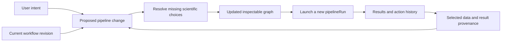

# Intents, evolving pipelines and business-function integration

Design from Gilles's UI discussion, 4 November 2026. The first implementation now provides metadata-only proposals, graph deltas and independent editable drafts. Automatic execution remains a later tranche. “Segment Cells” is an example of the general interaction, not a selected implementation priority.

## Implemented first tranche

Use **Process > Segment Cells...**, **Track Cells...**, **Measure Signals...** or **Analyze Cavity Trajectory...** to open the planner with an intended outcome selected. **Process > Plan Workflow...**, **Edit > Plan Workflow...** and **Plan...** in Pipeline open the general planner. **Process > Define ROIs...** opens the reusable main-image ROI assistant. Five curated intents currently cover ROI definition, segmentation, tracking, measurements and cavity trajectory selection. Their method candidates come from `detecdiv_modules_list`; only valid modules resolving on the active MATLAB path are offered. Existing uniquely matching enabled steps are proposed for reuse; ambiguous steps or new scientific methods require an explicit selection. Probability-only segmentation steps cannot supply masks.

The same compact Pipeline graph displays **Added**, **Reused step**, **Choose method**, and existing-resource states (**declared**, **unverified**, **partial**, **stale**). Resources appear as input nodes in the proposal view, separately from executable business nodes. Display ordering follows dependencies without reordering the source graph. Reusing a step preserves its effective parameters, including run overrides; it does not assert that its old scientific outputs are valid for a new target.

The inventory reads selected FOV/ROI metadata and already cached model metadata only. It never calls an image/model loader, probes raw paths, migrates annotations or starts Python. Common mask/family names are intersected across the selected FOV's ROIs; heterogeneous coverage is partial. Known GT naming prefixes are excluded, but provenance and scientific suitability still require verification. No channel name alone authorizes reuse of results. Typed metadata fingerprints detect changed contexts, including exact uint64 identities, without serializing image pixels or expanding entire cellular models into JSON strings.

**Use Draft** creates an independent `pipeline` with the proposed executable nodes/edges and baked effective parameters. It preserves existing branches, requires refresh after context changes, keeps source templates/runs intact, and clears invocation-specific identifiers/paths when forking. A proposal based on a saved run uses its frozen graph and run settings, rather than the currently edited live template. Added nodes initially contain their catalogue entry point/package; method defaults, model references and bindings remain to be configured through the existing advanced path. No run or H5 is created by applying a proposal. The button remains disabled while method choices are unresolved or the plan would be unchanged.

The new draft stays in memory until an explicit save. Save Pipeline asks for a parent folder for a new workflow and refuses an existing destination directory. Save Run uses the existing run persistence path and includes an additive `ctx.workflowIntent` record (`detecdiv.ui.intent_proposal.v1`): intent ID, parent proposal, scope, graph change summary, unresolved checks, source reference and applied-graph fingerprint. The record indicates whether the effective graph was subsequently amended, including through the advanced bridge. This metadata does not alter execution contracts or processing algorithms.

**History...** in the planning dialog shows the current project's bounded session proposal history and intent origins in already loaded project runs. Run-backed history survives reopening through `run.json`; unsaved session proposals are not durable revision storage. Readable details distinguish the originating intent from later graph edits. This is the first history integration, not the complete scientific-action journal.

Validation: `detecdivui.intentPlannerTest()` and `detecdivui.intentWorkflowTest()` cover missing/partial/stale resources, effective-step reuse, method ambiguity, cycles, source preservation, native controls/docking, stale proposals, frozen run forking, advanced edits, independent saves, provenance and cross-project isolation. The planner appends or reuses curated recipe steps; it does not yet replace/prune arbitrary advanced graphs, invalidate downstream scientific outputs, certify reusable artifacts, instantiate module defaults, execute from a task button, or implement drag-and-drop. Planning/applying drafts never implies inference.

## Central interaction

The user expresses an intent. DetecDiv proposes a change to an inspectable pipeline, taking account of the selected data, compatible existing results and the current workflow. One action launches a traceable execution; manually creating a run is optional advanced work.

The pipeline is the evolving analysis plan, not just a hidden execution artifact. The compact Pipeline graph shows what exists, what is proposed and what needs attention. The same plan is accessible in pipeline2 for detailed editing. Guided controls and the advanced editor must share one configuration and run identity.

The user interface need not include a natural-language chat. Menus, context actions, drag-and-drop and concise task dialogs can all express structured intents. Free-text interpretation, if added later, must produce the same proposal and validation rather than execute unreviewed commands.

## Three responsibilities

| Layer | Responsibility | Existing foundation |
| --- | --- | --- |
| Intent/action profile | User vocabulary, essential questions, contextual assistant, common presets and completion affordance | New thin UI metadata/adapters; reuse ROI, Contours, Tracks and Data widgets |
| Workflow planner | Compare desired resources with current ones; propose additions, bindings, replacements or branches; explain affected results | Independent `pipeline`, node contracts, module catalogue and binding/validation helpers |
| Execution | Freeze selection/configuration, validate, execute, save results and report status | `pipelineRun`, `runPipelineDry`, `runPipeline`, existing local/Hub dispatch and run ledgers |

An action is not necessarily one function or one node. One intent can require several modules; one module can support several intents. Do not reproduce every legacy callback as a toolbar button, or build a separate execution path per dialog.

Not every interaction becomes a pipeline node. Navigation, contrast and read-only inspection remain view operations. Contour/track corrections remain explicit scientific draft transactions. Their commits can invalidate downstream results and appear in history without pretending that interactive gestures are batch processors.

## Discovery and UI metadata

Use `detecdiv_modules_list` as the module catalogue. Discovery must remain metadata-only: no execution, `setparam`, Python activation, model loading or raw-image probing at startup. `pipelineNodeContract` and package contracts describe typed inputs/outputs, selectors and parameter ownership. `executionSpec` is used on demand for a selected method, not speculatively across every installed package.

A read-only catalogue query on this worktree returned 30 built-in modules and no diagnostics: 8 loading/ROI modules, 12 processors and 10 classifiers. Two declare modern manifests (`cellposesam`, `cellLatentModel`); the other 28 use legacy discovery. This does **not** mean their business functions lack contracts or are unusable. It means user intent cannot yet be inferred reliably from manifest capability names alone.

Add curated action profiles referencing catalogue module IDs and contract resources. Profiles describe the intent, compatible method candidates, basic parameter roles, assistant to open and advanced destination. They must not duplicate package defaults, numerical validation, model paths, inference code or an independent module-discovery registry. Preserve legacy adapters while enriching metadata incrementally.

Examples of frontend parameter roles are input channel, object family, target selection, output name and existing-output policy. Scientific choices such as resident mother versus daughter-tip trajectory belong in the concise task dialog. Python paths, device allocation and detailed numerical settings normally belong in advanced controls, with relevant failures still visible.

## State-aware planning

Planning uses a selected Project/FOV/ROI scope and a resource inventory. Available resources include raw references, ROI definitions, extracted images, masks, cellular-model families, stable identities, parentage, dataseries and artifacts. Track frame/channel coverage and producer/run provenance, not just names or file existence.

Distinguish absent, available, incompatible, stale, partially available and unverified resources. Planned outputs are not completed results. Existing data without sufficient provenance needs an explicit compatibility check or adoption decision; a matching channel name is not proof of a reusable result. Do not infer biological TrackIDs from frame-local labels, or use GT as a prediction output.

1. Match the intent to required logical resources and the active workflow.
2. Prefer compatible existing results and explicit user method choices.
3. Propose only missing or changed dependencies, with deterministic supported recipes.
4. Ask for unresolved scientific choices or conflicting bindings. Do not silently invent a classifier, a channel, parentage semantics or a model release.
5. Show a compact graph change: reused, added, modified, affected downstream, or awaiting input.
6. On the task's launch button, freeze and validate the effective plan/target, create a run and dispatch it through the existing path. No obligatory intermediate New Run or Save Run step.

Initial recipes should be curated and testable. Do not attempt unconstrained composition of every compatible-looking module or silently repair arbitrary advanced graphs. Complex/unrecognized graphs remain inspectable and executable through advanced tools.

### Example: tracking from an existing segmentation

With compatible masks already available, a tracking intent proposes a tracking node bound to that provider, not another segmentation. If masks are absent, the proposal includes the missing segmentation prerequisite and asks for a method if no explicit compatible preset exists. A failed/missing source is presented as a prerequisite to resolve through the existing relink/import tools.

If tracking and identities already exist, offer inspection, a new method/branch or a scoped rerun as appropriate. Distinguish continuing an incomplete run from creating a new invocation. Changing the segmentation upstream marks dependent tracking/measurements as affected; it does not automatically overwrite their data or rerun them merely because the graph was edited.

### Example: cavity analysis

The repository's existing cavity implementation is `selectCavityTrajectory` with `cavityTrajectoryView` and Score's `score_cavityTrajectoryDialog`. It consumes cellular identities/parentage and selects an experimental role, rather than re-tracking contours. Reuse a compatible existing family/model and expose the role and cavity geometry. Then show the trajectory, confidence, gaps and lineage in coordinated views.

Do not identify this automatically with the separately mentioned “cavitylineagemap” application: no exact application source under that name was located in the checked MATLAB workspace. Its actual entry points and additional features still need an inventory before claiming parity. Integrating the available cavity renderer must not trigger legacy model migration or modify identities as a side effect of opening a view.

## Evolving the pipeline without rewriting history

Keep three identities separate:

- **Template:** an independent `pipeline`, reusable across projects.
- **Working plan:** an editable revision of the active workflow plus its project/selection bindings.
- **Run:** a `pipelineRun` with frozen effective graph, parameters, input selection and code/model provenance.

Project metadata may reference workflows and their active revisions. Do not make pipeline templates physical children of `shallow` again, introduce a competing template class, or assume one project can have only one workflow. The exact on-disk working-plan revision schema remains to be specified before implementation.

An intent can append a node, fill a binding, change a setting or propose a branch. Always calculate the delta against the revision from which the dialog was opened; reject/rebase stale proposals if advanced editing or another action changed that revision. Preserve advanced user edits. If a recipe cannot safely amend them, offer a new branch or open the relevant advanced section.

Changing a plan is undoable until committed/executed and has no computational side effect. Changing a previously executed plan creates a new revision and a new run. Previous runs remain inspectable. Their effective execution configuration is frozen; status/progress may evolve and compatible resume attempts must remain traceable. Restoring an old plan must not imply deleting or rolling back scientific outputs.

Reuse a template only when its effective configuration, resource bindings and semantics match. Never rewrite an independent user template to make it fit a guided action. Resume requires the runner's existing compatibility policy; “skip existing” is not a substitute for provenance-aware planning.

## Project construction and guidance

File > New Project / Import and file dropping must enter the same import intent. A drop is a proposed input, not authorization to infer its scientific role or execute a pipeline.

Classify supported inputs using explicit formats: project, pipeline, classifier, raw image file/series or directory. Resolve ambiguous MAT/JSON contents and mixed drops before attaching them. A directory is not automatically a new project or a recursive raw-data scan. Retain a file-picker route for equivalent functionality.

The importer should request only missing information: project destination, source layout, channel/time interpretation, etc. It delegates parsing to dataloaders. After metadata import, propose Define ROIs on the main Image viewport. Manual/pattern/grid/tracked definitions use the existing assistant; extraction/materialization is a distinct step and remains visible in the plan when required by the selected backend. This design does not change H5 storage.

Guidance follows the selected objective and prerequisites rather than forcing a fixed wizard. The tree/breadcrumb locates the user; contextual commands and the Pipeline graph show available next actions. Tooltips/status explain disabled actions. Do not add a permanent onboarding paragraph or expose internal class fields to explain the workflow.

No supported native file-drop callback was found among the public Figure properties inspected on local R2026a. Browser/native docking integration still needs an isolated proof: real local paths, multiple files, no arbitrary JS execution, no lost events after floating/redocking and parity with the file picker. Do not substitute a filename-only HTML upload that cannot resolve the actual raw source, or claim drag-and-drop has shipped.

## History and progressive disclosure

The user sees semantic history: imported sources, defined ROIs, changed a plan, executed an analysis, saved corrections, exported results. Each entry identifies target scope, outcome and associated workflow revision/run/artifacts. Navigation and slider movements are not scientific operations.

Use two linked levels:

1. A concise action history, with selection to navigate to relevant data/results and inspect the corresponding plan.
2. Existing run reports/events for effective parameters, module/code/model identities, node statuses, errors, cancellation and diagnostics. Reuse `pipelineRunEvent`, `pipelineRunEventsRead` and `pipelineRunReview`.

Link an intent/proposal ID to the workflow revision and run. Persist started/completed/failed/cancelled distinctly. An editing draft is not a saved scientific result. Show persistence failures and retain recoverable state; do not call an action completed merely because its dialog closed or a worker accepted a job. The action-history storage format and relocation rules still need definition; avoid creating another ad hoc project log before that contract is settled.

Local undo changes a draft/plan. Undoing an executed computation is a different operation requiring explicit output/version handling. History can repeat an action as a new proposal with its old settings; it must check current data/provenance and allocate a new run rather than silently replaying destructive writes.

Basic mode hides machinery, not material decisions: target scope, selected method, created/replaced outputs, progress and failures remain accessible. Per-action Advanced opens the same configuration in pipeline2 or the appropriate settings dialog. Hub connection remains shared infrastructure, independent of any one task.

## Implementation order and acceptance

1. **Integration matrix:** map Score/Pipeline/cavity capabilities to user intents, resource requirements, reusable modules, assistants and execution/edit/view behavior. Enrich selected legacy metadata before relying on automatic discovery.
2. **Read-only planner:** propose additions/bindings/reuse against a working revision; render graph deltas and unanswered questions. No execution, output writes or automatic source reads.
3. **Common action controller:** freeze/validate/apply a proposal; hand off to existing draft transactions or pipeline execution; establish semantic history links and locking/cancellation/persistence handling.
4. **Project-building vertical slice:** Import/New Project → inspect raw FOV → Define ROIs → materialize if required. Add drag-and-drop only once the real-path/native-docking proof passes.
5. **Analysis vertical slices:** choose representative intents from segmentation, tracking, quantification and cavity analysis to verify that the common mechanism works; no commitment to implement segmentation first. Include parameter changes and downstream impact.
6. **Parity and expert round-trip:** expand the audited feature matrix while preserving advanced graph edits and historical runs.

Required scenario tests include reuse of compatible masks, missing prerequisites, stale/mixed-frame results, explicit method ambiguity, draft protection, immutable run history, cross-project isolation, two workflows on one project, advanced-editor round-trip, failed saves/cancellation, and reopen/relocation. Inspect/propose/import metadata must not start inference, migrate annotations or probe unavailable raw roots.

## Code anchors

- Catalogue: `helpers/detecdiv_modules_list.m`, `structure/io/pipelineModuleAudit.m`.
- Contracts/parameters: `pipelineNodeContract.m`, `pipelineNormalizeNodes.m`, package `executionSpec`/contracts, `pipelineApplyRunNodeParams.m`.
- Binding/validation: `pipelineResolveBindings.m`, `validatePipeline.m`, `runPipelineDry.m`.
- Execution/provenance: `runPipeline.m`, `pipelineRunNew.m`, `pipelineRunSave.m`, `pipelineRunEvent.m`, `pipelineRunReview.m`.
- Frontend: `+detecdivui/Session.m`, `RunDraft.m`, `PipelineWidget.m`, `ROIWidget.m`, `MaskDraft.m`, `TracksWidget.m`, `DataWidget.m`.
- Cavity: `+selectCavityTrajectory`, `+cavityTrajectoryView`, `score_cavityTrajectoryDialog.m`.
